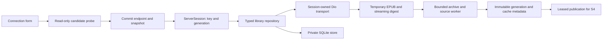

# Design: S3 server, library and publication foundation

Status: planning proposal, 2026-10-26, revised the same day after plan review
(duplicate ZIP names, import layout facts, file-backed worker archive, early
hosted SQLite gate). Requirements/acceptance are in
`prd.md`; source anchors and external primary sources are in `research/`.

## 1. Ownership and data flow



| Owner / proposed location | Responsibility |
| --- | --- |
| `core/config/` | Normalized endpoint, persistent selection primitives, immutable `ServerSession`, activation serial/generation. No feature imports. |
| `core/network/` | Session transport factory, prefix-safe URL construction, cancellation, status/error decoding and redacted logs. |
| `core/storage/` | Directory abstraction, SQLite connection/migration worker, atomic-file primitives and bounded cache/lease mechanics. No book/reader semantics. |
| `features/servers/data/`, `presentation/` | Health contract, candidate validation orchestration, connection/change form and state. |
| `features/library/data/`, `presentation/` | Snapshot/detail DTOs and repositories, snapshot cache ownership, read-only list/folder/book-preparation UI. |
| `features/reader/data/{epub,source,worker}/` | Bounded archive access, publication/source worker messages, prepared source/resource data. Pure Dart; no Riverpod, Flutter or `dart:ui`. |
| `app/` | Provider composition, typed routes and session activation UI integration. Reader adapters/providers stay outside the pure core. |
| `ios/Runner/Info.plist`, `tool/ci/` | LAN explanation and allowlisted app/probe build target. |
| `test/` | Synthetic HTTP, temporary storage, archive, concurrency and widget fixtures. |

Do not import `diagnostics` into product/reader code. Keep existing probe APIs
working through adapters where necessary. Existing `AppDirectories` is
extended with `caches()`; no second directory service. HTTP models use
Freezed/checked JSON; pure engine/worker values retain the existing handwritten
typed-model exception.

## 2. Endpoint identity and URL resolution

`ServerEndpoint` validates and stores a canonical deployment-root URI plus
its user-facing normalized text. Trim outer whitespace; require an explicit
HTTP(S) scheme and host; reject userinfo, query, fragment, invalid escapes,
backslashes and invalid ports. Canonicalize scheme/host case and default
ports, normalize literal dot segments and the final slash, preserve encoded
path segment boundaries. Do not decode/re-encode an entire path or fold path
case. Root and prefix are both first-class; IPv6/encoded-path tests establish
the exact implementation contract.

`ServerKey = sha256(canonicalRootString)` is a stable private namespace, not
authentication or a server-provided identity. Store the canonical string too
and compare it when opening the namespace. A URL alias is a distinct server;
there is no host-only matching, DNS-based merge or redirect-driven migration.

All API requests append relative `api/...` segments to this root. Backend
`/covers/...` is deployment-relative despite its leading slash: retain the
prefix and already encoded characters/query. Never request `coverPath`,
`fileName` or a server filesystem path. Cover bytes use the same injected
transport and session guard, not an independent unscoped `Image.network`.
Require cover responses to decode as images and bound byte/pixel caches.

Automatic redirect following is disabled at the session boundary. Accept at
most five manually validated same-origin redirects within the deployment
prefix, with loop detection. Cross-origin/prefix redirects or HTTPS downgrade
return a recoverable connection error directing the user to enter the final
deployment root. An HTML login page is never a valid health/snapshot/file.

## 3. Activation, retry and lifecycle

State flow: `restoring -> unconfigured | selected`; candidate flow:
`editing -> validating -> committing -> selected` or a recoverable failure.

1. Give each candidate attempt a serial and separate cancellation owner.
   Validate health then an unconditional snapshot without changing the active
   session or leaking candidate data into its providers.
2. Decode both responses. Persist endpoint + validated snapshot + active
   selection in one SQLite transaction. On storage failure keep the old
   active endpoint; a usable network response alone is not activation.
3. Serialize activation commits. Within the same coordinator, advance the
   session generation and retire old transport/work before admitting new
   session actions. The DB and UI cannot be truly atomic together: a crash
   after commit restores the new selection; a failed commit keeps the old one.
4. Cancel old requests, dispose old controllers/workers, reset old route stack
   and image state, then expose the new immutable session. Every HTTP, file,
   cover, worker and publication result checks its captured key/generation
   immediately before publication. A -> B -> A must reject the first A's work.
5. A stale/canceled operation is control flow, not a retryable network error.
   Keep cancellation separate from `NetworkException`; only read requests
   use the existing bounded retry policy. UI disposal and worker exit complete
   every waiting future and release partial-file/lease ownership.

On relaunch restore only the committed endpoint. A valid cached snapshot may
be displayed with a stale/offline label while a refresh runs. Failed refresh
preserves data and selection. A newer durable database schema or unrecoverable
DB error offers retry/recovery and preserves the file, not factory reset.
A process restart creates a fresh generation; temporary work is reconciled
before new publication.

LAN denial cannot be reliably inferred from every socket failure. Provide
accurate permission/network troubleshooting without claiming a denial was
detected when transport evidence only establishes unreachability. Never
auto-retry a superseded connection attempt.

## 4. Typed HTTP contract

S3 implements only these reads:

| Route under deployment root | Return and handling |
| --- | --- |
| `GET api/health` | Require `status=ok`, `service=epub-reader-server`, `database=ok`; tolerate additive fields. |
| `GET api/library/snapshot` | `{snapshot:{schemaVersion:1,version,books,folders,shelf,recent}}`; 200 or bodyless 304. |
| `GET api/books/:id` | `{book:BookDto}`; missing 404 is a recoverable deleted/unavailable book. |
| `GET api/books/:id/file` | Complete EPUB bytes; conditional 304 only with a verified local generation. |
| `GET covers/...` | Optional thumbnails/covers, bounded and session-owned. |

The snapshot already includes every book and folder membership; no catalog,
per-folder or root-only book-list request is needed for this milestone.
Introduce their DTOs when S5/S6 actually consume those endpoints.

Do not decode `SnapshotBook` as `Book`; detail-only fields are absent from the
snapshot. Required nullable fields must distinguish missing from null; preserve
null vs zero progress. Check finite values/ranges, positive JS-safe IDs,
nonnegative safe versions/sizes and enum tags. Ignore unknown additive fields.
Validate unique keys, joins and consistent folder/shelf ownership before
publishing a normalized index. Unknown snapshot schema is incompatible.

Use an explicit server timestamp converter: SQLite `YYYY-MM-DD HH:mm:ss`
means UTC; accept explicit-offset timestamps and normalize their instant.
Keep the original timestamp string where later acknowledgment/order semantics
need exact wire data. Do not apply device-local parsing or rewrite raw values.

The transport separately inspects redirect statuses before following a
validated target. Only snapshot/file request decoders admit 304 as a valid
terminal status; choose body decoding after status. Persist snapshot payload + ETag + schema together. Send the exact
opaque ETag only for a usable same-server snapshot. Missing/corrupt/incompatible
cache or a cache lost while the request runs triggers one unconditional fetch.
A second bodyless 304 becomes a protocol error, not a retry loop. Responses
without validators are valid but cannot use conditional reuse. Snapshot revision
does not represent file identity or statistics freshness.

Classify failures at repository boundaries: cancellation; connection/timeout;
TLS/certificate; 401/403; HTTP failure; incompatible service/schema; malformed
payload; local-storage failure; invalid/unsupported publication. Add exception
subtypes only for genuinely different UI/retry behavior. Never show raw response
HTML, stack traces, endpoint paths or library content in logs/error messages.

## 5. Durable state and migrations

Use one versioned SQLite database in Application Support, owned by a single
long-lived background isolate. Expose asynchronous typed commands; no database
handles or synchronous SQL on UI/motion paths. Use transactions, bound SQL
parameters, foreign keys, serialized writes and checked migration versions.
Verify rollback/journal settings and interrupted-transaction behavior on actual
resolved SQLite. Database changes and filesystem renames are separate commits.

Schema v1 owns:

- `servers`: key, canonical endpoint and local creation/last-use metadata.
- `app_state`: one active server key and schema metadata.
- `library_snapshots`: server key, raw validated payload/schema, opaque ETag,
  revision, fetch timestamp; one current snapshot per server.
- `cached_publications`: server key + book ID + byte digest, private relative
  path, actual bytes, opaque ETag/Last-Modified, parser version, validation
  status and access timestamp.
- `book_cache_heads`: server key + book ID -> current validated generation.
- `cache_operations` only if required by the implemented crash-recovery
  protocol; do not introduce a generic job engine.

S4 adds its accepted-checkpoint/outbox tables through explicit migrations.
S3 does not invent activity schemas or unused generic payload tables.
The shared contract is transactional migration/namespace ownership: cache
eviction can delete only cache-owned tables/files, never a whole server
directory/database or future durable rows. Migration tests preserve unrelated
sentinel data; future-schema downgrade must fail without mutation.

Proposed new direct dependencies: `sqlite3` (MIT; current primary documentation
describes 3.x native hooks), `crypto` (BSD-3-Clause; already resolved transitively
at 3.0.7). Keep the current SDK/codegen pins. Resolve a compatible lockfile in
Phase A. iOS packaging is an early gate, not a Phase F discovery: before
Phase B builds on SQLite, a hosted build of an existing entry point must
package the chosen SQLite library, survive the user's selected on-device
signing route (S1 device runbook) and open, commit, reopen and refuse a
future schema under Application Support on the iPhone. Check in the resolved
version's documentation whether the package can link the system SQLite
instead of bundling its own library; choose whichever passes that gate with
fewer packaged artifacts. A gate failure stops S3 for a storage-driver plan
revision. Do not add drift/codegen or a second
SQLite driver absent a demonstrated need. Dependency/IO failure is not
permission to replace transactional storage with best-effort preferences.

## 6. Download, identity and atomic publication

Public handoff identities:

```text
BookKey(serverKey, positiveBookId)
ContentIdentity(BookKey, sha256, parserVersion, canonicalVersion)
PublicationLease(identity, sourceSession, release)
ContentChange(previousIdentity?, newIdentity) // no progress mutation
```

A downloaded generation is immutable. The file path contains generated
namespace/digest components, not a title, supplied filename or raw URL.

Preparation sequence:

1. Capture session and per-book operation generation; coalesce ordinary
   duplicate preparations. Manual refresh supersedes older work for the same
   BookKey. Pin the target book's previous verified head for the whole attempt,
   including quota reservation, so LRU cannot evict the fallback on failure.
   Fetch current detail and validate existing metadata/file.
2. If local length/digest/parser compatibility is valid, send the opaque ETag
   (`If-None-Match`), or Last-Modified when no ETag is available. If no valid
   local file exists, request the full representation unconditionally.
3. Stream a 200 body into a new private `.part` file, with actual byte limits,
   cancellation and progress; do not trust Content-Length for safety or hash
   identity. Hash on a worker/file stream without loading the whole file into
   an extra UI-isolate buffer. Accept EPUB or generic binary MIME only after
   package validation; reject obvious HTML/JSON errors.
4. For 304, recheck file identity/existence and session before reuse; otherwise
   do one unconditional request. Never use a 304 body.
5. S3 sends no Range/If-Range. Unexpected 206/412/416 cannot publish; allow one
   full unconditional recovery request, then fail. Resume downloads are deferred.
6. Close/flush the temp file; worker validates container/package and first
   source section, preserving package/per-item rendition facts and source
   viewport/resource metadata. Report layout facts (section 7) independently
   from malformed content. No layout class is an import failure: valid
   fixed-layout, mixed, RTL and vertical books complete preparation with
   their recorded facts, and none passes through S2's blanket
   `requireSupported()` gate. Fixed-page rendering and every renderer
   capability verdict, including the parent AC10 explanation for deferred
   vertical/RTL content, are owned by S4. Source readiness is not a promise
   that every later section renders; S4 handles later section errors
   without losing accepted position.
7. Check session and per-book generation, rename on the same filesystem into
   an immutable digest path, then transactionally publish metadata and the
   current-head pointer. On Windows, do not overwrite an open destination;
   reuse an already verified same-digest generation.
8. Only after DB commit may consumers acquire the new head. Previous leased
   generations remain available until release. Emit content change on a new
   digest; S4 must re-prove CFI and keep unresolvable checkpoints/events.

Failure before rename removes only the temp file. Failure/crash after rename
but before DB commit leaves an unreferenced file for reconciliation. DB commit
failure leaves the old head. Crash after commit leaves a verifiable new head.
Startup detects missing/corrupt referenced files and makes them unavailable
without deleting reader state. It removes only task-owned abandoned temp and
unreferenced files after reconciling metadata; never scans/deletes Documents.

An HTTP validator cannot detect all metadata-preserving replacements. A local
digest is an identity of obtained bytes, not proof of remote freshness.
Manual refresh is explicit and retains the old valid generation on failure.

## 7. Cache and worker bounds

Initial injectable engineering defaults for review/implementation:

| Resource | Limit / behavior |
| --- | --- |
| Compressed EPUB / entries / entry / aggregate expansion | Existing `EpubLimits`: 256 MiB / 20,000 / 64 MiB / 1 GiB. Count actual entry output, not only declared headers. |
| Persistent removable EPUB/cover bytes | 512 MiB total across all server namespaces; LRU only among unleased generations. |
| Downloads | One EPUB transfer at a time; normal duplicate requests coalesce. |
| Staging | At most one compressed file up to 256 MiB in addition to the retained-cache quota. |
| Compressed archive in worker | File-backed random access to the verified generation; never a whole-archive buffer. Resident compressed bytes are the central directory plus bounded read buffers (package default 64 KiB per stream), independent of archive size; Phase A sets the measured ceiling. |
| Publication worker | One active publication per preparation flow; serialized requests, bounded pending queue (8) and explicit close. |
| Retained expanded resource bytes | 128 MiB in worker/cache; stream/hash discovery and evict unleased resources. No whole-book eager retention. |
| Cover bytes / decoded images | 16 MiB encoded-cache sub-budget within the 512 MiB disk cap; 16 MiB decoded LRU; reject an individual >8 MiB encoded cover and use a placeholder. |

These are ceilings, not allocation goals or an offline guarantee. Reserve
budget before writing; if pinned generations prevent admission, report cache
busy/storage failure instead of evicting live content. Report a recoverable
limit error for an individual unsupported large input; do not drop content or
raise the limit invisibly to pass a fixture. Account for worker transfer/copy
overhead and test bounded retention; disk quota is not a process RSS bound.

Worker contract: `open(path, identity)`, `loadSection(index)`,
`readResource(path)`, `close()`, with typed request ID/session/content tags,
error/exit listeners and stale-message rejection. Worker owns file handles,
ZIP decompression, resource discovery, source parsing and canonical indexing.
Return immutable metadata/source snapshots and bounded transferable bytes.
Do not send a lazy `EpubBook` back to the UI and thereby move later decompression
back there. Pure Dart values may be transferred; no Flutter object, plugin,
database handle or `dart:ui` object crosses this boundary.

`open(path, identity)` reads the immutable generation file-backed. Today
`EpubArchive.open` takes the whole compressed archive as one `Uint8List`
(`lib/features/reader/data/epub/epub_archive.dart:29`). With fixed-layout and
image-heavy books in scope, near-limit archives are expected, and a 256 MiB
resident buffer per open book beside the retained-resource budget is not
acceptable. Add a file-backed constructor over the same raw-directory index
below (archive 4.5.2 `InputFileStream` with `ZipDirectory.read`), keeping the
in-memory constructor for the probe and tests. Phase A must prove that entry
reads stay lazy, file handles are shared and released by `close()`, and worker
resident memory does not grow with archive size. Download hashing stays
incremental while streaming; preparation never rereads the whole file into
one buffer.

The existing layout API directly accepts `EpubBook`/`EpubArchive`. Define the
small resource/source access seam and a preloaded adapter so S4 can consume
worker-prepared content without lazy UI-thread inflation. Preserve the probe's
in-memory adapter and the source oracle. S3 proves the adapter on synthetic
source/resource fixtures; full reader/page integration remains S4. Font
registration, image decoding, paragraphs, painting and layout stay on the root
isolate outside active motion; this plan does not move `dart:ui` to a worker.

Preserve raw package rendition, itemref override/side/spread/orientation
properties, source viewport declarations, SVG dimensions and source identity
in the handoff. Classification and structural/source readiness are distinct
from a versioned renderer-capability verdict.

The existing `UnsupportedLayoutReason` mixes a layout mode (`fixedLayout`)
with deferred features (RTL progression/direction/language, vertical
writing), and `BookLayoutSupport.supported` is all-or-nothing
(`lib/features/reader/engine/support/unsupported_layout.dart:15`). The product
path therefore records a separate layout-facts value instead of that verdict:

- Per-section layout mode (reflowable/fixed after package and itemref
  overrides) and the raw rendition properties above.
- Package-level facts derived without loading sections: spine
  `page-progression-direction` and the primary publication language.
- Style-derived facts (writing mode, root/body direction, RTL run count) only
  for sections the worker actually loaded and styled. Every other section is
  explicitly `notInspected`, never assumed horizontal/LTR. S3 does not run
  `detectBookLayout`'s whole-book load-and-style pass at import.

No fact in this value fails import. S4 computes the renderer verdict when it
opens a section and owns the recoverable explanation for deferred vertical/RTL
content (parent AC10), keeping one owner for capability decisions. The
archived S2 probe keeps `detectBookLayout(...).requireSupported()` and its
historical refusal. No fixed renderer or new whole-page gesture is
implemented in S3. See the parent `research/fixed-layout-expansion.md` for the
expanded S4 requirements and source evidence.

Inflation implementation must be evidence-driven: cached archive 4.5.2 already
contains limited output and chunked decoding, but app checks currently happen
after decoder construction/entry allocation. Check raw directory count/sizes,
symlink behavior and actual emitted bytes before accumulation; reuse verified
bounded APIs with an app-owned counting sink. Audit stored/deflate paths,
CRC/truncation, duplicate names (below) and aggregate bounds. Count each physical entry's
validated output against publication limits without charging repeated reads as
new content; retained-resource bytes and per-operation output remain separate
budgets. Do not
assume `decodeStream` or `verify: true` alone proves those properties.
See the early implementation gate and `research/storage-and-import.md`.

Duplicate entry names are a known divergence, not only a missing test. In the
resolved archive 4.5.2, `ZipDecoder.decodeStream`
(`lib/src/codecs/zip_decoder.dart:50-61` in the package) finds the earlier
entry for a repeated name and keeps its content, applying only the later
header's mode. `EpubArchive` (`epub_archive.dart:23`) and `reader-engine.md`
document last-duplicate-wins like the reference `fflate.unzipSync`, and no
current fixture contains a duplicate. S3 builds the entry index from the raw
central-directory headers (`ZipDirectory.fileHeaders`) instead of the
coalesced `Archive` list: the last occurrence supplies content, and every
physical entry counts toward entry and aggregate limits. Bypassing the
decoder loop also removes its eager symbolic-link read; link mode bits are
never followed and the entry stays ordinary bytes, as in the reference. The
fix lives in the shared archive layer, so it intentionally changes merged S2
parsing of duplicate-name archives for the probe as well. Existing vectors,
none of which contain duplicates, must stay unchanged; add generated
duplicate-name fixtures through the existing oracle tooling
(`tool/oracle/README.md`) and record the behavior change.

## 8. UI and device build

Proposed typed routes: setup/change connection, `/` read-only library,
folder by ID, book by ID with preparation state. Deep routes also capture the
session and reset on activation; passing only a numeric Book ID across a
server switch is unsafe. Pass IDs, not entire models, through typed routing.

Use existing localization/theme infrastructure; loading/cancel/retry and
permission troubleshooting are ordinary user language. Preparation succeeds
with book metadata and a clear ready state; hashes, worker terminology and
database details belong in tests/diagnostics, not product copy. No reader
controls or progress/statistics writes are implied. The final parity tokens
and shell are delivered in S5/S6.

The current CI script hardcodes `main_probe.dart`. Add an allowlisted build
mode `probe|app` through the existing workflow/manual input and script.
Keep `probe` as the default and its two-IPA diagnostic behavior; `app` targets
`lib/main.dart`, emits one default-`FlutterMetalLayer` IPA, and records entry
point/artifact identity. Keep the same workflow counter, SDK/actions pins,
bundle ID and provenance checks; no arbitrary source target supplied by users.
Existing public-push authorization and user-operated signing/device steps
remain execution boundaries, not permission to publish during planning.

Add `NSLocalNetworkUsageDescription`; verify real Dio and cover transport.
Do not blindly enable global ATS exceptions, disable TLS verification, add
Bonjour/multicast or change the server's CORS. Test actual plain HTTP and HTTPS
where available, including direct local-IP/prefixed proxy deployments. Host
mocks cannot establish iOS permission/ATS behavior.

## 9. Compatibility, rollback and S4 handoff

- Preserve diagnostics marker/export files and APIs. Product runtime selection
  must not use `API_BASE_URL` as a silent fallback; retain build identity flags.
- New storage lives under a separate versioned product root. Old builds may
  ignore it but must not be used to downgrade its schema. Never recover by
  deleting the DB, all server state or the last known file.
- S4 receives `BookKey`, session generations, verified content identity,
  worker/source-resource API, the layout-facts value (with `notInspected`
  sections), lease release, content-change events and the migration owner. Checkpoint/outbox behavior is designed by S4 against those
  contracts.
- A server 404 or changed snapshot marks a book unavailable; cache cleanup is
  independent of future saved-state deletion. Snapshot revision decrease can
  indicate server restore; do not compare revisions across activations as if
  globally monotonic.
- Same URL reused for a different backend database cannot be distinguished
  perfectly by the current protocol. Do not claim a durable deployment UUID;
  retain the parent's separately owned compatibility/content identity handoff.
- Spec updates in implementation: data-layer endpoint/casing/persistence rules,
  cancellation/errors, directory ownership, worker/import contract, testing and
  dependency/build quality guidance. Planning edits no code or global specs.
